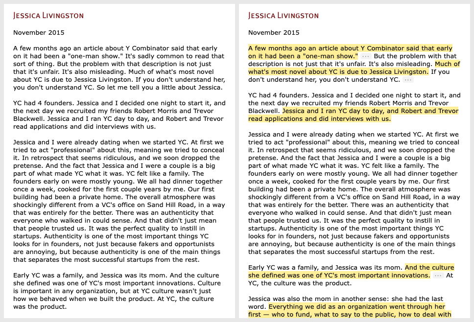

# Unpad

Removes the filler from articles and long posts, in the author's own words.



## Install

1. Download and unzip the extension from the [releases page](https://github.com/SamuelZ12/filler-cut/releases). For a source build, follow [Development](#development).
2. Open `chrome://extensions` and turn on **Developer mode**.
3. Select **Load unpacked** and choose the unzipped folder. The setup page opens.

## Connect

- Select **Continue with ChatGPT** to use an eligible ChatGPT Plus or Pro plan. Grant plan access in the sign-in tab. Use **Manage usage** to review your plan or app limit.
- Select **Use an API key instead** and paste a key from Anthropic, OpenAI, Google Gemini, or OpenRouter. Google offers a free Gemini tier in eligible regions. [Get a Gemini API key](https://aistudio.google.com/apikey)

Open the sample article after you connect. In **About you**, you can tell Unpad what you already know or what you’re working on.

## Use

- Press **Option+Shift+F** on Mac or **Alt+Shift+F** on other platforms to turn cuts on or off. To see or set your shortcut, open `chrome://extensions/shortcuts`. You can also use the switch in the extension popup.
- Select **···** to expand the original sentences. Select the expanded text to hide it again. Hold **Shift** to see the full text until you release it.
- Yellow highlights mark key points. The toolbar badge counts hidden sentences.
- Cuts run automatically on X after you connect. On another site, use the shortcut once, or check **Always run on** in the popup to enable future articles on that site.

## Privacy

Page text and your optional **About you** notes go directly from the browser to the provider you choose. There is no Unpad server or activity logging with ChatGPT or an API key. Provider data policies apply, including Google’s use of free-tier prompts to improve its products. The optional bridge runs separately and keeps local logs. [Privacy policy](PRIVACY.md) · [Gemini data terms](https://ai.google.dev/gemini-api/terms)

## How it works

Unpad splits the article into sentences and asks your provider which ones to keep and highlight. It replaces each group of hidden sentences with a marker and keeps the original text available in the page. It caches the selection on your device.

## Advanced

To run the bridge on your own machine, install [Bun](https://bun.sh/) and [Pi](https://pi.dev/), and sign in to Pi with access to its configured model. From the repository folder run:

```sh
bun install
bun run bridge
```

In extension settings, open **Advanced** and enter `http://127.0.0.1:18931` under **Bridge URL**. Use HTTPS for a bridge on another device. The bridge keeps its cache and logs under `~/.pi/agent/filler-cut/data` by default. Set `FILLER_CUT_DATA` to choose a different directory or `FILLER_CUT_RULES` to supply a reader notes file.

On macOS, run `scripts/bridge-service.sh install` to start the bridge at login. To reach it from another device over Tailscale, add `--tailnet` to the install command. Use Tailscale access rules to limit who can reach this port. Clients that reach it can send requests to Pi.

For a build with a preset connection, set `BRIDGE_URL` to its origin when you run the build.

## Development

```sh
bun install
bun run build
bun run check
bun run zip
```

Load `dist/extension` in Chrome. The zip command uses the system `zip` tool to create a clean store archive in `dist/`. See [live verification](tests/live/README.md) for the browser checks.

## License

Unpad is free and open source under the [GNU Affero General Public License v3.0](LICENSE).
